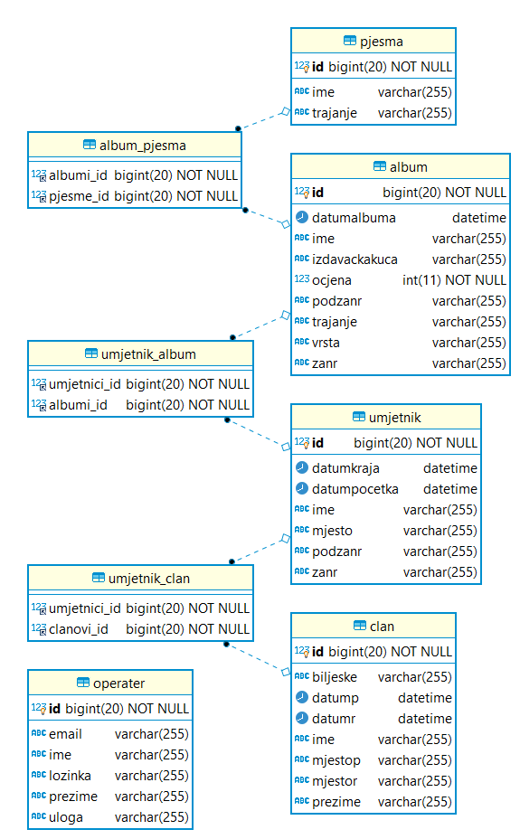

# Music Collection Manager

A Java desktop application developed as my final project for the Edunova programme. It provides a graphical interface for managing a music collection and stores its data in a MariaDB database using Hibernate.

## Features

- Manage albums, songs, artists, and bands
- User login with administrator access
- Persist application data with Hibernate and MariaDB
- Music playback support

## Database design



## Built with

- Java 14
- Java Swing
- Hibernate
- MariaDB
- Maven

## Getting started

### Requirements

- JDK 14 or a compatible newer version
- Maven
- MariaDB

### Setup

1. Clone this repository.
2. Create the database:

   ```sql
   CREATE DATABASE music_hib CHARACTER SET utf8mb4;
   ```

3. Open `src/main/resources/hibernate.cfg.xml` and update the database URL, username, and password to match your local MariaDB setup.
4. Open the project in an IDE and run `hr.edunova.jp22.Start`.

Hibernate is configured to update the database schema when the application starts.

To build the executable JAR with Maven:

```bash
mvn clean package
```

The JAR, including its dependencies, is created in the `target` directory.

## Project structure

- `src/main/java` — application source code
- `src/main/resources` — Hibernate configuration and application resources
- `pom.xml` — Maven project configuration
- `era-diagram.png` — entity-relationship diagram
